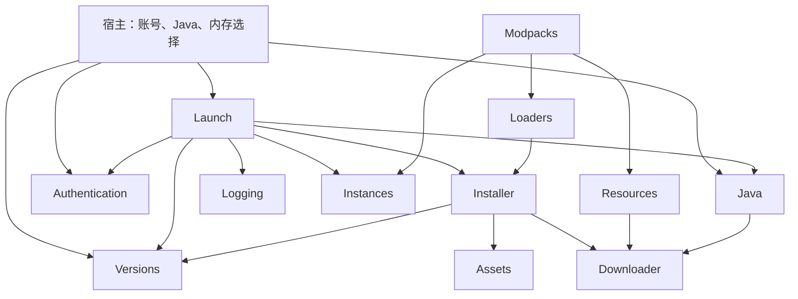

# 完整源码架构

公开入口只有 FMCore 单核心类库。公开方案 FMCore.slnx 不引用本地 CLI/测试；独立文档示例是使用方项目，不打包进 NuGet。

## 完整核心源码目录

```text
FMCore/
  Assets/AssetIndex.cs
  Assets/AssetManager.cs
  Authentication/AccountManager.cs
  Authentication/AccountModels.cs
  Authentication/AccountPersistence.cs
  Authentication/IAccountTokenStore.cs
  Authentication/MicrosoftAuthentication.cs
  Authentication/OfflineIdentity.cs
  Authentication/WindowsDpapiTokenStore.cs
  Downloader/DownloadException.cs
  Downloader/DownloadManager.Convenience.cs
  Downloader/DownloadManager.cs
  Downloader/DownloadOptions.cs
  Downloader/DownloadPath.cs
  Downloader/DownloadProgress.cs
  Downloader/DownloadRequest.cs
  Downloader/DownloadResult.cs
  Downloader/FileVerification.cs
  FMCore.csproj
  FmCore.cs
  Installer/GameInstaller.cs
  Installer/InstallationModels.cs
  Installer/InstallationPlanner.cs
  Installer/InstallationVerification.cs
  Installer/NativeExtractor.cs
  Instances/.gitkeep
  Instances/InstanceFiles.cs
  Instances/InstanceLock.cs
  Instances/InstanceManager.cs
  Instances/InstanceModels.cs
  Instances/InstancePaths.cs
  Java/JavaCompatibility.cs
  Java/JavaDiscovery.cs
  Java/JavaException.cs
  Java/JavaManager.cs
  Java/JavaModels.cs
  Java/JavaProbe.cs
  Java/JavaProcess.cs
  Java/JavaRuntimeModels.cs
  Java/JavaRuntimeUtil.cs
  Java/JavaUtil.cs
  Java/JavaVersion.cs
  Java/RuntimeArchive.cs
  Java/RuntimeCatalog.cs
  Java/RuntimeFiles.cs
  Java/RuntimeInstallation.cs
  Launch/GameServerConfig.cs
  Launch/LaunchArguments.cs
  Launch/LaunchConfig.cs
  Launch/LaunchModels.cs
  Launch/LaunchSettings.cs
  Launch/MinecraftLauncher.cs
  Launch/SecretRedactor.cs
  Loaders/.gitkeep
  Loaders/FabricInstaller.cs
  Loaders/FabricMetadata.cs
  Loaders/FabricModels.cs
  Loaders/ForgeInstaller.cs
  Loaders/InstallerArchive.cs
  Loaders/InstallerLoader.cs
  Loaders/Java/FmcoreOptifineBridge.java
  Loaders/LoaderModels.cs
  Loaders/LoaderOperations.cs
  Loaders/NeoForgeInstaller.cs
  Loaders/OptiFineBridge.cs
  Loaders/OptiFineInstaller.cs
  Logging/.gitkeep
  Logging/CrashReportTracker.cs
  Logging/GameDiagnostics.cs
  Logging/LauncherLogger.cs
  Logging/LoggingModels.cs
  Logging/SensitiveDataFilter.cs
  Models/.gitkeep
  Modpacks/.gitkeep
  Modpacks/ArchiveEntryStream.cs
  Modpacks/ModpackArchive.cs
  Modpacks/ModpackExport.cs
  Modpacks/ModpackInstaller.cs
  Modpacks/ModpackModUpdates.cs
  Modpacks/ModpackModels.cs
  Modpacks/PackFiles.cs
  Modpacks/PackRelations.cs
  Modpacks/PackResourceScope.cs
  Resources/.gitkeep
  Resources/CurseForgeClient.cs
  Resources/CurseForgeInstaller.cs
  Resources/CurseForgeMetadata.cs
  Resources/CurseForgeModels.cs
  Resources/CurseForgeResolution.cs
  Resources/ModrinthClient.cs
  Resources/ModrinthInstaller.cs
  Resources/ModrinthMetadata.cs
  Resources/ModrinthResolution.cs
  Resources/ResourceFiles.cs
  Resources/ResourceInstance.cs
  Resources/ResourceImages.cs
  Resources/ResourceModels.cs
  Utilities/GameFiles.cs
  Versions/GameCoreUtil.cs
  Versions/LocalProfiles.cs
  Versions/LocalVersionInfo.cs
  Versions/MavenCoordinate.cs
  Versions/VersionException.cs
  Versions/VersionInheritance.cs
  Versions/VersionManager.cs
  Versions/VersionModels.cs
  Versions/VersionParser.cs
  Versions/VersionRules.cs
```

根目录工程配置：Directory.Build.props、Directory.Packages.props、global.json、FMCore.slnx；公开文档位于 docs/，CI 位于 .github/workflows/。本地私有开发入口为 FMCore.Local.slnx、FMCore.Cli/、FMCore.Tests/、scripts/、docs/validation/，均按 .gitignore 排除。

## 模块依赖与调用流程



典型流程：版本查询返回强类型目录；宿主选择版本、Java、账号及内存；GameInstaller 内部解析和安装；LaunchConfig.Create 组合已选对象；MinecraftLauncher 校验并启动、转发脱敏日志、等待退出和释放。Loaders 的 VersionId 直接进入同一启动流程。Modpacks 自己持有包级事务，宿主不自行搬移文件或维护备份。

完整运行项目见[综合示例](sample-launcher.md)，各功能调用见[独立示例](examples.md)。内部 Utilities 仅服务现有共享路径/哈希/文件行为，没有公开通用工厂或插件容器。

## 模块职责

| 目录 | 职责与主要依赖 |
| --- | --- |
| Downloader | URL/目标安全、并发、流式校验、重试、原子替换；其余下载模块复用 |
| Versions | 官方目录、缓存、本地 profile、继承、依赖坐标和条件规则；依赖 Downloader |
| Assets | 资源索引/对象与旧版 virtual/resources 映射；复用 Downloader |
| Java | 本机探测、兼容性，以及官方 Runtime 查询/精确安装；下载复用 Downloader |
| Installer | 统一安装计划、客户端/Libraries/Assets/natives/日志配置、校验与修复 |
| Authentication | 设备授权、OAuth、Xbox/XSTS、游戏资格/资料、离线身份与 DPAPI 存储 |
| Launch | 配置校验、参数 token、进程树、输出/退出与资源生命周期；复用版本/Java/安装/认证 |
| Instances | 不可变配置快照、修订更新、目录外稳定锁、安全删除与启动集成 |
| Loaders | Fabric 元数据与 Forge/NeoForge/OptiFine 官方安装器；复用统一安装和版本模型 |
| Resources | 两平台协议差异、必要依赖、来源记录、单项更新与失败恢复；共享实例锁和文件事务 |
| Modpacks | 有界归档解析、精确 Runtime、内容及来源/实例包级事务、计划/确认/清理/回滚 |
| Logging | 先过滤再事件/缓存/导出；有界证据诊断及当前会话报告候选 |
| Models / Utilities | 已实际使用的跨模块类型与内部安全路径、哈希、原子写辅助；不扩展通用框架 |

## 文件与事务边界

共享根包含 versions、libraries、assets；实例的配置、Mod、存档和日志位于实例目录。版本 ID、相对目录、归档路径和链接在内部校验，不由宿主拼内部路径。加载器生成依赖只校验复用，损坏时重跑对应加载器安装器。

普通下载按文件原子替换，原版安装保留有效文件供重试；不声明整个原版目录的全有全无事务。资源事务保护来源已确认的文件；整包事务同时覆盖内容、来源和实例配置，并提供独立主动回滚。Java Runtime 按精确包隔离，验证和探测后提交。恢复日志、备份、锁都由现有模块持有。

账号身份不进入实例持久化；Java/内存/Windows 优化选择属于宿主。Launch 使用 ArgumentList，不执行拼接 Shell 命令。日志先过滤凭据，诊断只报告证据，不推测确定根因。

## 本地与公开项目边界

公开的 FMCore.slnx 只构建 FMCore；docs/examples/FMCore.Examples.csproj 和 docs/sample-launcher/SampleLauncher.csproj 是独立使用方示例，IsPackable=false，不是核心依赖。维护者在 Rider 使用忽略跟踪的 FMCore.Local.slnx，保留核心、FMCore.Tests、FMCore.Cli 三项目。

CLI 只处理参数/显示并调用公开 API；测试、脚本、内部报告和临时文件分别位于 .gitignore 排除的本地目录。NuGet 只包含核心程序集/XML 与项目介绍、许可及更新日志，不包含示例可执行程序、CLI 或测试。
